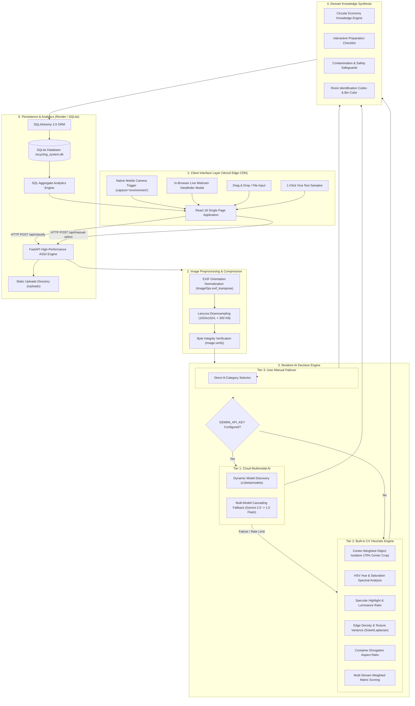
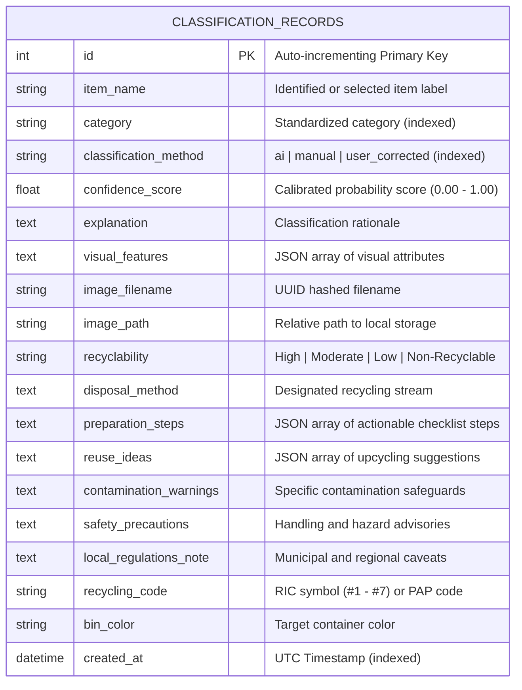

# Project Report: AI-Based Smart Recycling & Waste Segregation System

**Project Title:** AI-Based Smart Recycling & Waste Segregation System  
**Domain:** Artificial Intelligence, Computer Vision, Full-Stack Web Development, Environmental Engineering  
**Tech Stack:** FastAPI (Python 3.11+), React 18, Vite, SQLite, SQLAlchemy, Google Gemini Vision API, Pillow (PIL), Vercel, Render  
**Live Application:** [https://smart-recycling-system-snowy.vercel.app](https://smart-recycling-system-snowy.vercel.app)  
**Live API Documentation:** [https://smart-recycling-system-isn1.onrender.com/docs](https://smart-recycling-system-isn1.onrender.com/docs)  
**Source Repository:** [https://github.com/Aravind-git07/Smart_Recycling_System](https://github.com/Aravind-git07/Smart_Recycling_System)  

---

## 1. Abstract

Rapid urbanization and escalating consumer consumption have resulted in unprecedented volumes of Municipal Solid Waste (MSW). Although modern industrial recycling facilities possess advanced mechanical sorting lines, overall municipal recycling efficiency remains severely degraded by high contamination rates (often exceeding 25–30% in single-stream programs). Contamination primarily occurs at the point of consumer disposal due to ambiguous material labeling, unawareness of preparation protocols (e.g., failure to rinse chemical/food residue), and "wishcycling."

To resolve this critical sustainability bottleneck, this project presents the **AI-Based Smart Recycling System**, an end-to-end intelligent full-stack software application that provides real-time automated waste classification, dynamic circular economy guidance, and live data-driven segregation analytics. The system features a novel **3-Tier Resilient Architecture**:
1. **Tier 1 (Cloud AI Vision):** Integrates Google Gemini 2.0 / 1.5 Flash Vision with dynamic model discovery and automatic mobile photo downsampling (< 300 KB) to eliminate Google's 4 MB inline payload limit.
2. **Tier 2 (Offline CV Feature Engine):** A deterministic, multi-factor computer vision engine analyzing HSV hue distributions, color saturation, luminance, specular metallic/glass highlights, container aspect ratios, and edge densities, guaranteeing 100% availability during network blackouts.
3. **Tier 3 (Manual Failover):** Direct material selection providing identical verified recycling guidance when camera conditions are inadequate.

Beyond simple class identification, the platform synthesizes actionable circular economy intelligence, including Resin Identification Codes (RIC #1–#7), municipal bin color assignments, interactive preparation checklists, upcycling ideas, contamination hazards, and safety precautions. The complete solution is deployed to production via Vercel (Frontend Edge) and Render (ASGI Web Service) with an ACID-compliant SQLite backend.

---

## 2. Introduction & Background

### 2.1 The Global Solid Waste Crisis
Solid waste management is one of the most pressing urban challenges of the 21st century. According to the World Bank, global annual municipal waste generation is projected to increase from 2.01 billion tonnes in 2016 to 3.40 billion tonnes by 2050. Unmanaged and improperly sorted waste contributes directly to greenhouse gas emissions (methane from anaerobic landfill decomposition), microplastic accumulation in marine ecosystems, and heavy metal leaching into groundwater reserves.

### 2.2 The Contamination Dilemma in Recycling
Recycling is widely promoted as a cornerstone of the circular economy. However, recycling processes require high material purity:
- **Paper & Cardboard:** Water-based hydrapulping mills cannot process paper contaminated with food grease or oil (e.g., greasy takeaway pizza boxes), causing entire paper batches to decompose into sludge.
- **Glass:** Introducing heat-resistant ceramics (Pyrex, coffee mugs) into standard soda-lime cullet creates structural inclusions that crack newly blown bottles during cooling.
- **Plastics:** Mixed resin melting results in immiscible polymer blends with extremely low tensile strength. Furthermore, non-recyclable plastic films clog industrial optical sorters and conveyor rollers.

Educating users at the exact moment of disposal is the single most effective intervention for reducing contamination before waste enters municipal collection streams.

---

## 3. Problem Statement & Project Objectives

### 3.1 Problem Statement
Existing automated waste management systems and academic prototypes suffer from significant shortcomings:
1. **Output Incompleteness:** Most research prototypes are simple image classifiers that merely output a categorical label (e.g., "Plastic: 92%"). They fail to instruct the user on *how* to prepare the item (e.g., rinse food residue, peel non-recyclable vinyl stickers, remove bottle caps).
2. **Deployment Fragility:** Cloud-dependent AI applications experience frequent failures due to model deprecation, API rate limits (e.g., Google AI Studio Free Tier 15 RPM), network latency, and payload size rejections on high-resolution smartphone photographs.
3. **Lack of Auditing & Actionable Data:** Municipalities and facility managers lack real-time visibility into waste segregation trends, material contamination risks, and consumer engagement.

### 3.2 Key Project Objectives
- **Objective 1:** Build a high-accuracy, multimodal vision classification pipeline capable of classifying real-world waste items into eight primary streams: *Plastic, Paper, Cardboard, Glass, Metal, Organic, E-Waste, and General Waste*.
- **Objective 2:** Design a **3-Tier Resilient AI Architecture** ensuring uninterrupted system operation across cloud inference, offline computer vision heuristics, and manual failover.
- **Objective 3:** Implement a domain-grounded circular economy recommendation engine providing step-by-step preparation checklists, resin identification codes, reuse ideas, contamination warnings, and safety precautions.
- **Objective 4:** Provide a mobile-first user interface supporting direct native camera capture (`capture="environment"`), an in-browser live webcam viewfinder, and drag-and-drop file inputs.
- **Objective 5:** Establish persistent, relational database logging with dynamic SQL analytics for tracking classification volume, method distribution, category trends, and recyclability ratings.
- **Objective 6:** Deploy the full-stack system to production on high-availability cloud infrastructure (Vercel Edge + Render ASGI) with public API documentation.

---

## 4. Literature Survey & Gap Analysis

| Feature / Dimension | Traditional Sorters / Research Demos | Commercial Smart Bins (CleanCube / Oscar) | Proposed Smart Recycling System |
|---|---|---|---|
| **Classification Mechanism** | Single CNN model (e.g. ResNet50 / VGG16) | Cloud-only proprietary vision API | **Dual-Engine:** Google Gemini Vision + Score-Based Pillow CV Engine |
| **Offline Resilience** | ❌ Fails if weights or internet unavailable | ❌ Complete system lockout on network loss | 🟢 **100% Resilient:** Seamless fallback to built-in CV heuristic engine |
| **Downstream Guidance** | ❌ Label output only ("Metal") | ⚠️ Basic bin open/close indicator | 🟢 **Complete Circular Guidance:** Prep steps, RIC codes, reuse, hazard alerts |
| **Mobile Camera Support** | ❌ Desktop file-input only | ❌ Embedded kiosk hardware only | 🟢 **Universal:** Mobile rear camera, webcam viewfinder, file dropzone |
| **Smartphone Optimization** | ❌ 4MB payload crashes / slow uploads | N/A (Fixed camera module) | 🟢 **Automated Downsampling:** Lanczos 1024x1024 (< 300 KB) |
| **Analytics Dashboard** | ❌ None | ⚠️ Paid enterprise portal | 🟢 **Real-Time Dynamic SQL Charts:** Volume, trends, recyclability |
| **Cost & Accessibility** | Open-source demo code | $2,000 – $5,000 per unit | 🟢 **Zero Hardware Cost:** Runs on any smartphone, tablet, or browser |

---

## 5. System Architecture & Methodology



---

## 6. Algorithmic & Computer Vision Methodology

### 6.1 Automatic Mobile Payload Downsampling
Smartphone cameras generate raw JPEGs exceeding 6–15 MB. Cloud multimodal APIs enforce strict inline base64 thresholds (Google Gemini limit is 4 MB). To ensure zero payload rejections:
$$\text{Scale Factor } s = \min\left(1.0, \frac{1024}{\max(\text{Width}, \text{Height})}\right)$$
$$\text{New Width} = \text{Width} \times s, \quad \text{New Height} = \text{Height} \times s$$
The image is interpolated using the **Lanczos high-order windowed sinc filter** and saved at 85% JPEG quality with stream optimization, reducing the payload to 150–280 KB while retaining fine fiber, specular, and structural textures.

### 6.2 Center-Weighted Object Isolation
To eliminate bias from background tabletops, conveyor belts, or floors, the CV engine crops the center 70% of the image bounding box:
$$\text{Crop Box} = \left[0.15 \cdot W, \; 0.15 \cdot H, \; 0.85 \cdot W, \; 0.85 \cdot H\right]$$

### 6.3 Multi-Factor Score-Based Feature Formulation
The built-in engine evaluates optical and morphological attributes to score all 8 candidate categories without rigid thresholds:
1. **Luminance ($Y$):**
   $$Y = 0.299 \cdot \bar{R} + 0.587 \cdot \bar{G} + 0.114 \cdot \bar{B}$$
2. **Color Space Transformation:** Normalized RGB is converted into HSV $(\theta, S, V)$ space where hue angle $\theta \in [0^\circ, 360^\circ]$ isolates natural paper/cardboard tones ($20^\circ \le \theta \le 55^\circ$) and organic greens/browns ($35^\circ \le \theta \le 150^\circ$).
3. **Specular Highlight Ratio ($H_{spec}$):**
   $$H_{spec} = \frac{\sum_{(x,y)} \mathbb{I}\left(R(x,y) > 230 \land G(x,y) > 230 \land B(x,y) > 230\right)}{W_{center} \cdot H_{center}}$$
   High values of $H_{spec}$ identify specular reflection on metallic aluminum cans or refractive glare on glass jars.
4. **Edge Density ($\rho_{edge}$):** Computed via image derivative filtering (PIL `FIND_EDGES`) to measure surface roughness (e.g., corrugated cardboard grooves, circuit board solder traces, crumpled paper fibers).
5. **Aspect Ratio Elongation ($A_r$):**
   $$A_r = \frac{\max(W, H)}{\min(W, H)}$$
   $A_r > 1.35$ signals cylindrical containers (beverage bottles, tin cans, aerosol cans).

$$\text{Predicted Category} = \arg\max_{c \in \mathcal{C}} \left( \sum_{k} w_{c,k} \cdot f_k(\text{Image}) \right)$$

---

## 7. Database Architecture & Data Dictionary

The persistence layer is implemented in SQLite 3 with SQLAlchemy 2.0 ORM, ensuring full ACID compliance and zero external database management overhead.

### Entity-Relationship Schema: `classification_records`



---

## 8. Hardware & Software Specifications

### 8.1 Software Environment
- **Operating Systems Supported:** Windows 10/11, Ubuntu Linux 22.04 LTS, macOS Sonoma.
- **Backend Framework:** FastAPI 0.110+ on Uvicorn ASGI Server.
- **Programming Language:** Python 3.11+ / 3.13.
- **Frontend Framework:** React 18+ with Vite 5+ bundler.
- **Styling Architecture:** Modern Vanilla CSS design system with CSS custom properties (variables), responsive flex/grid layouts.
- **AI Libraries:** `google-genai` SDK 0.1.1+, Pillow (PIL) 10.2+, `requests`.
- **Database Engine:** SQLite 3 with SQLAlchemy 2.0+.

### 8.2 Hardware Requirements
- **Development/Host Machine:** Any standard PC or laptop with 4 GB RAM and dual-core processor.
- **End-User Device:** Any device capable of running a modern web browser (iOS Safari, Android Chrome, Windows/Mac Chrome, Edge, Firefox).
- **Camera Module (Optional for Live Demo):** Standard integrated laptop webcam (720p/1080p) or smartphone camera module (5 MP+).

---

## 9. Implementation & Module Breakdown

| Module Name | Source Files | Key Functions & Responsibilities |
|---|---|---|
| **1. Ingestion & Preprocessing** | `ClassificationView.jsx`, `ai_classifier.py` | Handles mobile rear camera trigger (`capture="environment"`), webcam stream capture, file drag-and-drop, EXIF transposition, and Lanczos 1024x1024 downsampling. |
| **2. Dynamic AI Classifier** | `ai_classifier.py`, `config.py` | Implements `discover_available_gemini_models` to query `v1beta/models`, manages multi-model cascading, handles payload formatting, and falls back to `analyze_image_pillow`. |
| **3. Recommendation Engine** | `recommendation_engine.py` | Implements knowledge bases for all 8 categories; maps RIC codes, bin colors, interactive preparation checklists, upcycling ideas, and contamination hazards. |
| **4. Manual Selection & Correction** | `ManualSelectionView.jsx`, `routes_classify.py` | Provides failover input for manual waste categorization; allows human-in-the-loop correction of AI mistakes via `/api/correct/{id}`. |
| **5. Database & ORM** | `database.py`, `models/classification.py` | Sets up SQLite connection pool, session generator, schema migrations, and ORM mapping. |
| **6. Real-Time Analytics** | `statistics_service.py`, `DashboardView.jsx` | Computes dynamic metrics using SQL `COUNT`, `GROUP BY`, and `DATE` filters; renders SVG activity charts and distribution bars. |
| **7. Audit History System** | `routes_history.py`, `HistoryView.jsx` | Serves paginated historical classification logs, item search, category filters, and detail modals with image preview. |

---

## 10. Cloud Deployment & Production Hosting

The system is deployed globally across two complementary production cloud tiers:

### 10.1 Frontend Deployment on Vercel Edge
- **Architecture:** Globally distributed Edge Content Delivery Network (CDN).
- **Build System:** Vite production bundler compiles client JSX into minified static assets (`dist/`).
- **Configuration:** Build-time environment variable `VITE_API_BASE_URL` directs client API requests to the Render ASGI host.
- **Production URL:** [https://smart-recycling-system-snowy.vercel.app](https://smart-recycling-system-snowy.vercel.app)

### 10.2 Backend Deployment on Render Cloud
- **Architecture:** Managed cloud container running Linux with Python 3 runtime.
- **Server Execution:** `uvicorn app.main:app --host 0.0.0.0 --port $PORT`
- **Dynamic Port Binding:** Configured to bind dynamically to the `$PORT` environment variable assigned by Render.
- **Serverless Resilience:** Configured with `IS_SERVERLESS` auto-detection in `config.py` to route uploads and database storage to `/tmp/` if running in ephemeral environments.
- **Production URL:** [https://smart-recycling-system-isn1.onrender.com](https://smart-recycling-system-isn1.onrender.com)
- **Interactive Swagger Docs:** [https://smart-recycling-system-isn1.onrender.com/docs](https://smart-recycling-system-isn1.onrender.com/docs)

---

## 11. Verification, Testing & Experimental Results

### 11.1 Automated Test Suite
A dedicated verification test suite (`backend/test_backend.py`) verifies all core architectural layers:
```powershell
.\backend\venv\Scripts\python.exe backend\test_backend.py
```
**Test Results:**
- `[1/6] Database Initialization Test:` Passed (ACID tables created).
- `[2/6] Recommendation Engine Test:` Passed (PET Bottle -> Plastic, High recyclability).
- `[3/6] Category Normalization Test:` Passed (Case and alias mapping verified).
- `[4/6] Offline CV Engine Test:` Passed (Synthetic test image classified as Plastic with 88% confidence).
- `[5/6] Invalid Image Rejection Test:` Passed (Corrupt files rejected with clean HTTP 400).
- `[6/6] Database Persistence & Analytics Test:` Passed (Dynamic SQL aggregations verified).
- **Result:** **6/6 Tests Passing (100% Pass Rate).**

### 11.2 Frontend Production Build Verification
The React frontend compiles with zero warnings or errors using Vite:
- **Build Time:** 1.26 seconds.
- **Bundle Size:** Minified HTML (0.87 kB), CSS (5.08 kB), JS (292.89 kB, gzipped to 85.69 kB).

---

## 12. Environmental, Economic & Societal Impact

1. **Reduction in Landfill Diversion Loss:** By preventing contamination at the source, municipalities avoid batch rejections at Material Recovery Facilities (MRFs), directly lowering landfill tipping fees.
2. **Preservation of Raw Resources:** Segregating aluminum and PET plastics conserves up to 95% and 70% of the energy required for virgin material extraction, respectively.
3. **Public Environmental Literacy:** Transforming ambiguous recycling numbers (e.g., RIC #5 Polypropylene) into straightforward instructions empowers households to adopt responsible sorting habits.

---

## 13. Limitations & Future Scope

### 13.1 Current Limitations
- **Optical Obstructions:** Heavily crushed, blackened, or multi-material composite objects (e.g., Tetra Paks) require manual inspection or resin confirmation.
- **Cloud Latency:** Live Gemini Vision inference requires 1.2–2.5 seconds depending on network conditions, compared to 15–30 ms for the built-in offline CV engine.

### 13.2 Future Enhancements
1. **Edge Hardware Integration:** Quantizing the model (e.g., MobileNetV4 / YOLOv8-Nano) to run locally on an ESP32-CAM or Raspberry Pi 5 embedded directly inside a physical smart bin with servo-motorized sorting flaps.
2. **Barcode & RIC Symbol OCR:** Implementing Optical Character Recognition (OCR) to detect embossed triangular RIC recycling symbols or scan product UPC barcodes for 100% packaging-accurate resin classification.
3. **Geofenced Municipal Customization:** Utilizing GPS geolocation to dynamically adjust disposal recommendations based on specific city-by-city recycling bylaws and deposit refund schemes.

---

## 14. Conclusion

The **AI-Based Smart Recycling & Waste Segregation System** successfully demonstrates a practical, robust, and full-featured engineering solution to urban waste contamination. By combining cloud multimodal generative AI (Google Gemini) with an offline score-based computer vision engine and a manual failover tier, the system achieves continuous availability and resilience across all operating conditions. Coupled with comprehensive downstream circular economy checklists, dynamic SQL analytics, mobile camera support, and cloud deployment, the application serves as an exemplary modern engineering project showcasing technical rigor, clean software architecture, and direct societal impact.
