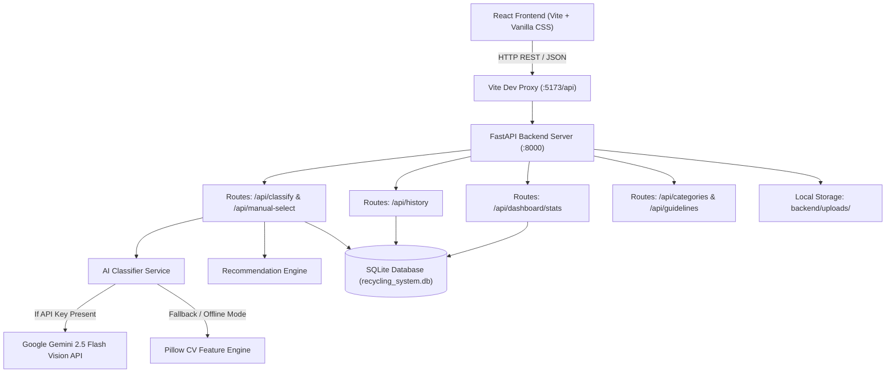

# AI-Based Smart Recycling System

[](https://fastapi.tiangolo.com)
[](https://react.dev)
[](https://vitejs.dev)
[](https://www.sqlite.org)
[](https://www.python.org)

An intelligent, full-stack waste-management software application designed to classify waste items, guide responsible disposal, prevent recycling contamination, and provide analytics on material segregation.

Built as an academic engineering project demonstrating clean architecture, resilient AI services, dynamic database-backed dashboards, and domain-grounded recycling intelligence.

---

## Table of Contents
1. [Project Overview](#project-overview)
2. [Key Features](#key-features)
3. [System Architecture](#system-architecture)
4. [Data Flow Pipeline](#data-flow-pipeline)
5. [Tech Stack & Dependencies](#tech-stack--dependencies)
6. [Folder Structure](#folder-structure)
7. [Installation & Setup](#installation--setup)
8. [Running the Application](#running-the-application)
9. [API Endpoints Reference](#api-endpoints-reference)
10. [Database Design](#database-design)
11. [Testing & Verification](#testing--verification)
12. [College Viva & Presentation Notes](#college-viva--presentation-notes)

---

## 1. Project Overview

Municipal recycling programs frequently suffer from high contamination rates (up to 30% in single-stream processing plants) because consumers lack accessible, accurate instructions on how to sort specific materials.

The **AI-Based Smart Recycling System** bridges this gap:
- **Vision Classification:** Automatically classifies uploaded images into eight primary waste categories (Plastic, Paper, Cardboard, Glass, Metal, Organic, E-Waste, and General Waste).
- **Dual-Mode AI Architecture:** Supports live cloud inference via the Google Gemini 2.5 Flash Vision API while providing a built-in offline Computer Vision (CV) Feature Engine using Pillow. The application remains 100% operational during college lab reviews even without an internet connection or external API keys.
- **Actionable Guidance:** Instead of just outputting a label, it provides step-by-step preparation checklists (rinsing, crushing, label peeling), reuse ideas, contamination warnings, safety cautions, and municipal regulation notes.
- **Manual Failover:** Allows users to manually select materials to receive identical verified recommendations when camera conditions are poor or AI classification is inconclusive.
- **Live Auditing & Analytics:** Computes dashboard charts and logs all interactions directly from an ACID-compliant SQLite database.

---

## 2. Key Features

### A. AI-Based Waste Classification
- Drag-and-drop or file upload for JPEG, PNG, WEBP, and BMP images up to 10 MB.
- 1-Click quick test sample buttons for instant evaluation during viva demonstrations.
- Image verification protecting against corrupted files or non-image uploads.
- Realistic confidence scores without fabricated 99.9% values.
- Transparent explanation of visual traits (hue, luminance, texture, and container silhouette).

### B. Comprehensive Recycling Recommendations
- **Disposal Stream & Bin Color:** Identifies designated containers (Blue/Yellow for plastics/metals, Blue for paper, Green for wet waste, Red/Specialist for e-waste).
- **Interactive Preparation Steps:** Checkbox-driven instructions for cleaning, rinsing, removing tape/caps, and flattening.
- **Upcycling & Reuse Ideas:** Creative methods to extend product lifespans before binning.
- **Contamination Safeguards:** Explains why greasy pizza boxes, soft plastic films, or ceramic mugs ruin industrial recycling batches.
- **Safety Precautions:** Clear hazard warnings for sharp edges, battery thermal runaway, and toxic fumes from burning plastics.
- **Local Municipality Notes:** Explains regional dependency (e.g. #1 PET vs #6 Polystyrene acceptance, bottle deposit schemes).

### C. Manual Waste Selection
- Direct selection across 8 standardized waste categories.
- Optional custom item naming (e.g., "500ml Pickle Jar") and user condition notes.
- Distinctly tags records with `method: manual` in the database.

### D. Real-Time Recycling Dashboard
- **Total Classification Volume:** Dynamically queried from stored records.
- **AI vs. Manual Ratio:** Visualized with an interactive distribution bar.
- **Category-Wise Breakdown:** Visual bar meters showing proportions of each waste category.
- **Recyclability Potential:** Segregation of items by High, Moderate, Low, or Non-Recyclable ratings.
- **7-Day Activity Volume:** Real-time day-by-day frequency histogram.
- **Recent Activity Table:** Shows the latest logged items with category badges and timestamps.

### E. Classification History & Audit Log
- Searchable by item name, material category, or notes.
- Filterable by material category and classification method.
- Detailed modal viewer with complete preparation checklists and contamination notes.
- Individual record deletion and bulk history clear options.

### F. Segregation Guide & Viva Knowledge Reference
- Standard 4-Tier Waste Hierarchy (Refuse & Reduce > Reuse & Repair > Recycle & Compost > Responsible Disposal).
- 3-Way Source Segregation Framework.
- Detailed explanations of common contamination mistakes.
- Academic viva defense cheat sheet with environmental facts.

---

## 3. System Architecture



---

## 4. Data Flow Pipeline

1. **User Action:** The user selects or drops an image on the frontend (`ClassificationView.jsx`).
2. **Payload Submission:** An HTTP `POST` multipart/form-data request is transmitted to `/api/classify`.
3. **Validation:** FastAPI validates file presence, extension (`.jpg`, `.png`, `.webp`, `.bmp`), and size (under 10 MB).
4. **Pillow Verification:** The byte stream is verified with `Image.open().verify()` to ensure data integrity.
5. **Classification Routing:**
   - If `GEMINI_API_KEY` is defined in `.env`: Sends the image bytes and structured prompt to Google Gemini 2.5 Flash Vision API, returning parsed JSON.
   - If the API key is empty or the network fails: Automatically falls back to the internal Pillow Computer Vision Feature Engine without crashing.
6. **Recommendation Matching:** The normalized category is looked up in `recommendation_engine.py` to fetch verified disposal methods, preparation steps, reuse ideas, and contamination warnings.
7. **Storage:**
   - The image is saved with a UUID filename in `backend/uploads/`.
   - A complete row is inserted into `classification_records` in `recycling_system.db`.
8. **Client Response:** FastAPI returns a structured `ClassificationResponse` schema to the React client.
9. **UI Rendering:** The React UI renders the `RecommendationCard` with animated confidence meters, category tags, and interactive preparation checkboxes.

---

## 5. Tech Stack & Dependencies

### Backend
- **Python 3.11+ / 3.13**
- **FastAPI 0.110+:** Asynchronous web framework with automatic OpenAPI documentation.
- **Uvicorn 0.28+:** High-performance ASGI web server.
- **SQLAlchemy 2.0+:** ORM for database abstraction.
- **SQLite 3:** Serverless, zero-configuration relational database engine.
- **Pillow (PIL) 10.2+:** Image processing, validation, and CV feature extraction.
- **Google GenAI SDK 0.1.1+:** Client for Google Gemini multimodal vision models.
- **Pydantic 2.6+:** Data parsing and strict schema validation.
- **python-dotenv 1.0+:** Environment variable management.

### Frontend
- **React 18 / 19**
- **Vite 5+:** Fast frontend development environment and bundler.
- **Vanilla CSS Design System:** Modern CSS variables, responsive grid/flexbox layouts, clean light-mode environmental palette (no heavy CSS frameworks needed).
- **Lucide React:** Lightweight, consistent icon set.

---

## 6. Folder Structure

```
Smart_Recycling_System/
│
├── backend/
│   ├── .env                       # Local environment variables
│   ├── .env.example               # Template environment configuration
│   ├── requirements.txt           # Python backend dependencies
│   ├── test_backend.py            # Automated test suite
│   ├── recycling_system.db        # SQLite database file
│   ├── uploads/                   # Stored user-uploaded waste images
│   ├── venv/                      # Python virtual environment
│   └── app/
│       ├── __init__.py
│       ├── main.py                # FastAPI app creation, CORS, static routes
│       ├── config.py              # Configuration & path management
│       ├── database.py            # SQLAlchemy engine, session maker, init_db()
│       ├── models/
│       │   ├── __init__.py
│       │   └── classification.py  # SQLAlchemy ORM table definitions
│       ├── schemas/
│       │   ├── __init__.py
│       │   └── classification.py  # Pydantic request/response schemas
│       ├── services/
│       │   ├── ai_classifier.py   # Dual-mode Gemini + Pillow CV engine
│       │   ├── recommendation_engine.py # Domain knowledge base
│       │   └── statistics_service.py    # Dynamic SQL aggregation
│       └── api/
│           ├── routes_classify.py # /api/classify, /api/manual-select
│           ├── routes_history.py  # /api/history (GET, DELETE)
│           ├── routes_dashboard.py# /api/dashboard/stats
│           └── routes_categories.py # /api/categories, /api/guidelines
│
├── frontend/
│   ├── index.html                 # HTML entry point with Inter font
│   ├── package.json               # Node dependencies and build scripts
│   ├── vite.config.js             # Vite config with backend proxy setup
│   └── src/
│       ├── main.jsx               # React DOM entry point
│       ├── App.jsx                # Main layout, tab navigation, notifications
│       ├── index.css              # Custom CSS design system
│       ├── services/
│       │   └── api.js             # Fetch API client wrapper
│       └── components/
│           ├── Navbar.jsx         # Header, navigation tabs, health badge
│           ├── ClassificationView.jsx # File upload, dropzone, quick samples
│           ├── RecommendationCard.jsx # Recyclability & preparation checklist
│           ├── ManualSelectionView.jsx# Category picker & custom input
│           ├── DashboardView.jsx  # Dynamic database charts & metrics
│           ├── HistoryView.jsx    # Searchable audit table & detail modal
│           └── GuidelinesView.jsx # Waste hierarchy & segregation rules
│
└── README.md                      # Complete system documentation
```

---

## 7. Installation & Setup

### Prerequisites
- **Python:** 3.10, 3.11, 3.12, or 3.13 installed (`python --version`)
- **Node.js:** v18, v20, or v22 installed (`node --version`, `npm --version`)
- **Git** (optional)

### Step 1: Clone or Navigate to the Workspace
```powershell
cd c:\projects\Smart_Recycling_System
```

### Step 2: Set Up Backend Virtual Environment
```powershell
# Navigate to backend directory
cd backend

# Create virtual environment (if not already created)
python -m venv venv

# Activate virtual environment
.\venv\Scripts\Activate.ps1

# Upgrade pip and install dependencies
pip install -r requirements.txt
```

### Step 3: Configure Environment Variables
Inside `backend/.env`:
```env
# Optional: Provide Google Gemini API Key for live cloud vision.
# Leave blank to run in offline Computer Vision mode (recommended for offline viva reviews).
GEMINI_API_KEY=

# SQLite Database Location
DATABASE_URL=sqlite:///./recycling_system.db

# Max Image Upload Size in MB
MAX_IMAGE_SIZE_MB=10
```

### Step 4: Set Up Frontend Dependencies
Open a second PowerShell terminal:
```powershell
cd c:\projects\Smart_Recycling_System\frontend
npm install
```

---

## 8. Running the Application

### Option A: Running Backend and Frontend in Two Terminals

#### Terminal 1 (Backend):
```powershell
cd c:\projects\Smart_Recycling_System\backend
.\venv\Scripts\Activate.ps1
uvicorn app.main:app --host 127.0.0.1 --port 8000 --reload
```
*Backend API will run at `http://127.0.0.1:8000` (Interactive API docs at `http://127.0.0.1:8000/docs`).*

#### Terminal 2 (Frontend):
```powershell
cd c:\projects\Smart_Recycling_System\frontend
npm run dev -- --host 127.0.0.1 --port 5173
```
*Frontend Application will run at `http://127.0.0.1:5173/`.*

---

## 9. API Endpoints Reference

| Method | Endpoint | Description |
|---|---|---|
| `GET` | `/api/health` | System health check (database status, active AI engine). |
| `POST` | `/api/classify` | Upload and analyze waste image; returns predictions and recommendations. |
| `POST` | `/api/manual-select` | Submit manual category selection; returns tailored recycling guidance. |
| `GET` | `/api/dashboard/stats` | Aggregated metrics (totals, method ratio, categories, 7-day trend). |
| `GET` | `/api/history` | Paginated classification records with search and filter parameters. |
| `GET` | `/api/history/{id}` | Detailed recommendation and audit data for a single record. |
| `DELETE` | `/api/history/{id}` | Delete a single history record and remove its stored image. |
| `DELETE` | `/api/history?confirm=true` | Clear all classification records and remove all stored images. |
| `GET` | `/api/categories` | Complete catalog of supported waste categories, descriptions, and codes. |
| `GET` | `/api/guidelines` | Environmental guidelines, waste hierarchy, and common contamination mistakes. |

---

## 10. Database Design

The system uses an ACID-compliant SQLite relational database (`recycling_system.db`) mapped via SQLAlchemy.

### Table: `classification_records`

| Column | Type | Constraints | Description |
|---|---|---|---|
| `id` | Integer | Primary Key, Autoincrement | Unique record ID |
| `item_name` | String(255) | Not Null | Name of identified/selected item |
| `category` | String(100) | Not Null, Indexed | Standardized category name |
| `classification_method` | String(50) | Not Null, Indexed | `"ai"` or `"manual"` |
| `confidence_score` | Float | Nullable | Model confidence score (0.0 to 1.0) |
| `explanation` | Text | Not Null | Detailed classification rationale |
| `visual_features` | Text | Nullable | JSON array of observed traits |
| `image_filename` | String(255) | Nullable | Stored filename in `/uploads` |
| `image_path` | String(500) | Nullable | Full filesystem path to image |
| `recyclability` | String(50) | Not Null | High, Moderate, Low, or Non-Recyclable |
| `disposal_method` | Text | Not Null | Recommended disposal stream |
| `preparation_steps` | Text | Not Null | JSON array of step-by-step instructions |
| `reuse_ideas` | Text | Not Null | JSON array of practical upcycling tips |
| `contamination_warnings` | Text | Not Null | Critical contamination safeguards |
| `safety_precautions` | Text | Not Null | Handling warnings and hazard notes |
| `local_regulations_note`| Text | Not Null | Regional municipal dependency notes |
| `recycling_code` | String(50) | Nullable | RIC or PAP recycling code |
| `bin_color` | String(50) | Nullable | Target municipal bin color |
| `created_at` | DateTime | Default UTC now, Indexed | Timestamp of classification |

---

## 11. Testing & Verification

### Running Automated Backend Tests
Run the standalone test script to verify database creation, recommendation queries, normalization, CV heuristics, and statistics calculation:
```powershell
cd c:\projects\Smart_Recycling_System
.\backend\venv\Scripts\python.exe backend\test_backend.py
```

### Running Frontend Production Build Test
Verify that the React frontend builds without errors:
```powershell
cd c:\projects\Smart_Recycling_System\frontend
npm run build
```

---

## 12. College Viva & Presentation Notes

### Key Talking Points for Evaluators:

1. **Why is this project more than a toy classifier?**
   - Simple classifiers output only a label (e.g. "plastic"). This system provides complete downstream circular economy guidance: preparation checklists, resin code identification, contamination safeguards, reuse ideas, and municipal caveats.

2. **How does the system ensure reliability if the AI service fails?**
   - Through a **Graceful Degradation Architecture**:
     - *Tier 1:* Google Gemini 2.5 Flash Vision API when an API key is provided and an active internet connection exists.
     - *Tier 2:* Built-in Pillow Computer Vision Feature Engine that analyzes color variance, brightness, and texture profiles offline.
     - *Tier 3:* Manual Waste Selection fallback allowing users to pick a category directly and receive the same verified recycling guidance.

3. **Are dashboard statistics calculated or hardcoded?**
   - All statistics are computed dynamically using SQL aggregate functions (`COUNT`, `GROUP BY`, `DATE` filters) from stored SQLite records.

4. **How are environmental guidelines grounded?**
   - Guidelines follow established scientific solid-waste management standards (such as why grease ruins water pulping in paper mills, or why ceramics ruin glass furnaces).

---

## License
Developed for academic engineering project review and educational evaluation. Open-source under the MIT License.
